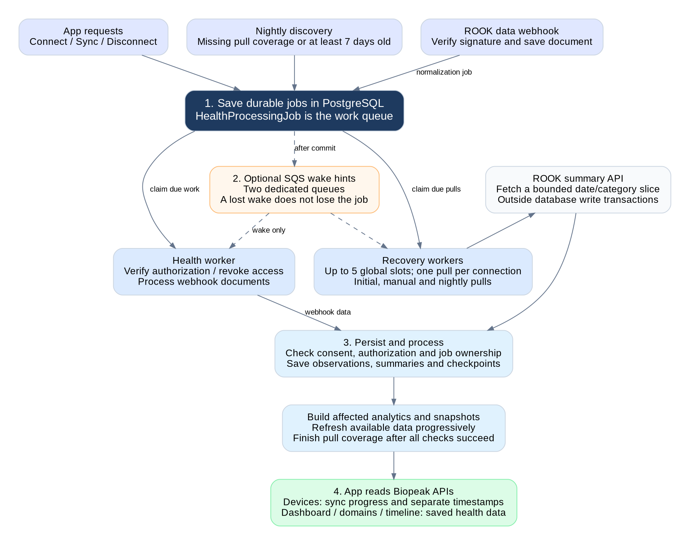

> **Historical behavior note:** Current client endpoint is GET `/api/v1/devices/providers/` and POST `/api/v1/devices/sync/`. Older endpoint references below are not current.

# ROOK Phase 1 improvements — 10 November 2026

This document describes the updated candidate built from `Biopeak_ROOK_Parallel_Workers_Updated(1).zip` and the client's Longitudinal Health Platform PRD. It is the current ROOK operating guide; older manager-flow and parallel-worker documents describe earlier versions.

## Agreed flow

The existing PostgreSQL job queue, dedicated health/recovery consumers, optional SQS wake hints, global five-slot recovery cap, six-hour manual cooldown and checkpointed pull pipeline remain. Nightly discovery selects consenting, authorized API connections with missing `synced_through` or coverage at least seven days old. The task runs at midnight in Django `TIME_ZONE` (`Asia/Kolkata`). Regular webhooks continue between nightly runs. Mode/threshold/timezone are hardcoded (no `ROOK_NIGHTLY_*` env).

Connect obtains the interactive ROOK URL synchronously. Authorization verification is queued. Successful verification queues the initial pull. A valid browser return is navigation/verification handoff, never independent proof of access. Native SDK sources still use on-device permissions and deliver data through the existing pipeline.

Webhook receipt stores the validated document and its processing job together. Recovery fetches physical, sleep and body summaries outside write transactions. Each bounded slice persists/deduplicates documents, maps already-resolved ROOK data into Biopeak observations, saves date/category checkpoints and updates available analytics. Continuations resume the saved window. Only a completed pull advances precise pull coverage.

Disconnect closes local ingestion immediately, fences old jobs and queues remote revocation. History is retained. Reconnect is blocked while remote revocation remains pending. Genuine errors retry with the existing bounded backoff. Provider-budget waits and expected confirmation delays defer without consuming failure attempts.



## What changed

1. **Revocation ordering:** grant epochs are recorded in existing `WearableConnectionEvent` rows under `authorization_granted`, keyed by the current authorization generation. A normal sync cannot move that epoch. Negative notifications are compared with the confirmed grant, never with a recovery import timestamp. Old connections without a recorded epoch do not invent an authorization time or suppress a negative notification on that basis.
2. **Recoverable authorization failures:** exhausted verification changes the matching pending connection into Provider Error with a retry action. Explicit Connect starts a fresh generation. Old exhausted jobs are not silently reopened. Reconciliation/status refresh identifies legacy exhausted checks too. A first-time authorization timeout returns to Never Connected; reconnect expiry retains the reconnect path. ROOK authorized-source 422 responses wait within the existing authorization deadline.
3. **Provider-aware revocation:** ordinary confirmation retains the 30-minute default. Withings allows 48 hours, with 15-minute polling after the first five minutes. Waiting does not consume failure attempts. Both deadlines are bounded configuration, not guaranteed provider SLAs. Local access remains blocked throughout.
4. **Progress metadata:** connection responses add `syncProgress`, `lastCheckedAt` and `latestMeasurementAt`. Approved health-card states are unchanged. List reads batch the latest-job and observation lookups.
5. **Honest no-data outcomes:** new recovery jobs count committed new/corrected observations atomically with processing. Replayed documents do not count as new measurements. Finished zero-observation jobs return `completed_no_new_data`; older jobs with unknown counters do not invent that conclusion. A disabled initial import is `skipped`.
6. **Processing performance:** previous-observation source-change checks use one PostgreSQL query for the document rather than one query per observation. Optional shared-health-cache reuse avoids some duplicate member/date summary requests across provider jobs. It is off for DummyCache/LocMemCache, lasts 15 seconds by default, never caches empty pulls and falls back to direct pulls on supported cache outages. It does not coalesce simultaneous cache misses or require Redis.
7. **Failure actions:** job metadata distinguishes user reconnect/retry from support action for server/configuration errors. Provider/source permissions and existing data remain authoritative.
8. **Test maintenance:** legacy callback/timeline fixtures now reflect generation-fenced authorization and full-range timeline gap computation. Provider configuration fallback follows the active Django settings module.

## Additive API contract

Existing URLs, request bodies, authentication and `{detail, data}` envelopes remain. The additional connection fields appear on existing connection-bearing responses, including GET `/api/v1/devices/` and retry-sync responses. No extra polling endpoint is required.

| Field | Meaning |
|---|---|
| `lastCheckedAt` | Successful completed pull time. Null means no completed pull is recorded. |
| `latestMeasurementAt` | Latest current observation's actual measurement time attributed to the source. It is not an arrival or processing time. |
| `lastDataProcessedAt` | When newly delivered data was processed. Preserved for an empty recovery check. |
| `lastWebhookReceivedAt` | Delivery receipt time. The existing ingestion helper is shared with recovery, so this legacy field is not a precise transport-only audit. Do not use it for measurement freshness or pull coverage. |
| `lastSuccessfulSync` | Existing compatibility field; can advance for webhook processing or a successful pull. Prefer explicit fields above for new UI. |
| `syncedThrough` | Frozen upper bound of fully checked pull coverage, not a promise that no later provider correction can arrive. |

`syncProgress.status` is `queued`, `processing`, `waiting`, `completed`, `completed_no_new_data`, `failed` or `skipped`. `operation` identifies verification, recovery or revocation. `nextRetryAt` is supplied for automatic waits. `recoveryAction` can be `retry_sync`, `reconnect`, `retry_disconnect` or `contact_support` on a terminal failure.

Per-domain metadata is in fixed Sleep, Activity, Heart, Recovery, Body, Workouts order. Each entry carries `syncState`, `hasStoredMeasurements` and `newMeasurementsProcessed`. `checked` means relevant summary endpoints were visited; it does not prove the provider supports the metric or that measurements exist. Read the dashboard/domain APIs for card state and values.

`diagnostics.checkedUnits` and `totalUnits` count date/category requests. Seven dates mean 21 units. This is not a health-history percentage. Keep request counters in diagnostics/support views. Show members domain progress and already available values. An ordinary live sync must not reset usable cards to an initial-history spinner.

### Example: successful empty check

The following timestamps are illustrative, not member data:

```json
{
  "lastCheckedAt": "2026-11-10T10:00:00Z",
  "latestMeasurementAt": "2026-11-10T08:00:00Z",
  "lastDataProcessedAt": "2026-11-10T08:05:00Z",
  "syncProgress": {
    "operation": "recovery_pull",
    "status": "completed_no_new_data",
    "message": "Checked successfully. No new measurements were available.",
    "nextRetryAt": null,
    "recoveryAction": null,
    "diagnostics": {"checkedUnits": 21, "totalUnits": 21}
  }
}
```

The response also includes the existing fields, a real job identifier, request/completion timestamps and per-domain metadata. Completion with no new data does not become a new card state. Waiting for Data, No Data, Unsupported and Permission Required retain their distinct PRD meanings.

## Configuration preserved and additions

| Setting | Behavior |
|---|---|
| Nightly mode/threshold/TZ | Hardcoded: `stale`, 7 days, Django `TIME_ZONE` (`Asia/Kolkata`). |
| `ROOK_REVOKE_CONFIRMATION_MINUTES` | New optional unprefixed setting/env control, default 30. |
| `ROOK_WITHINGS_REVOKE_CONFIRMATION_HOURS` | New optional unprefixed control, default 48, allowed 24–168. |
| `ROOK_SUMMARY_CACHE_SECONDS` | New optional unprefixed control, default 15, allowed 1–60. Only used with an existing shared health cache. |
| `ROOK_API_REQUESTS_PER_MINUTE/DAY` | Existing mandatory approved account budgets. No guessed quota. |

The runtime controls above accept Django settings or unprefixed deployment variables. Do not assume a DEV_/STG_/PRD_ alias exists for a new runtime control. Production and staging pre-existing history remain disabled as in the source package. ROOK must activate the entitlement and Biopeak must deliberately change its deployment setting before enabling history. Existing six-hour cooldown and worker infrastructure remain.

## Schema and deployment

This update changes no models and adds no further schema requirements. The original ZIP already lacked migrations for seven connection fields, six job fields, two coordination/budget models and the running-recovery uniqueness constraint. The cumulative field/type inventory is `ROOK_SCHEMA_REQUIREMENTS_20261110.json`.

Repository policy assigns migration generation to the owner. Generate/review migrations against the actual current client branch, test upgrades on a staging copy, commit the reviewed result, and apply it once. Do not fake migration history. The release preflight now also selects all authorization/coverage fields used by this update. It remains a read-only check, not migration or provider certification.

```bash
uv sync --frozen --python 3.14
# Repository owner: generate and review the migration on the actual branch.
uv run --python 3.14 python manage.py makemigrations wearables
uv run --python 3.14 python manage.py migrate --plan
uv run --python 3.14 python manage.py migrate
uv run --python 3.14 python manage.py check_rook_release
uv run --python 3.14 python manage.py test wearables.tests --verbosity 2
```

Validate authorization, initial/live data, manual cooldown, nightly eligibility, out-of-order revokes, expected Withings delay, worker loss, duplicate/corrected data, empty checks and real SQS/ROOK behavior before production rollout. See the current validation record for executed checks and limitations.

## Boundaries

Recovery continues to fetch summaries only. This change does not promise to reconstruct every event-only webhook. Clinical thresholds, insights, notifications, AI and Phase 2 analytics are unchanged. Raw-payload/account-deletion retention needs the client's explicit policy. Actual provider quotas, entitlements and reconnect backfill require ROOK confirmation. These operational decisions cannot be established by offline tests.

## Sources

- Client: `Biopeak Longitudinal Health Platform — PRD (2).html`, sections 2.2, 4.2–4.6, 5.1.3, 5.2.1, 6.5, 8.3, 9, 10.1 and 12.
- Senior's two supplied authorization/sync/revocation diagrams.
- User's confirmed nightly selection, 10 November 2026.
- ROOK API reference, revocation behavior: https://docs.tryrook.io/api/ (Withings confirmation can be delayed overnight).
- Original code package and this change register. No client database or AWS environment was accessed.
